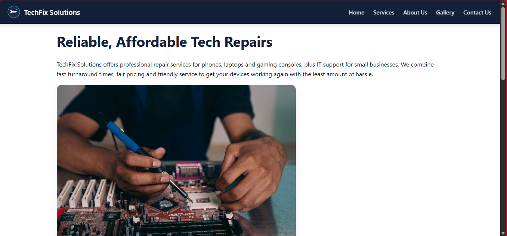
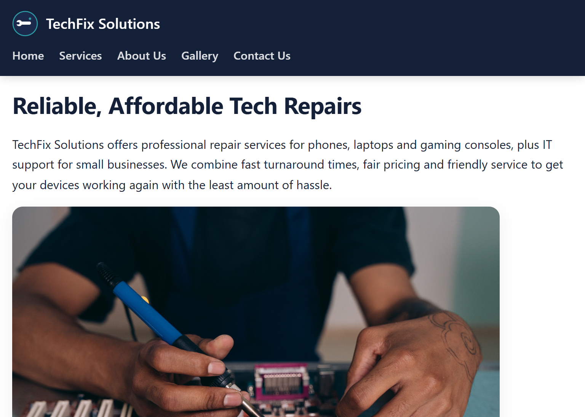
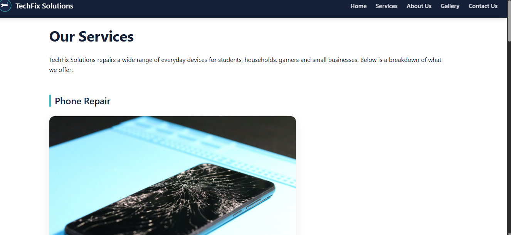
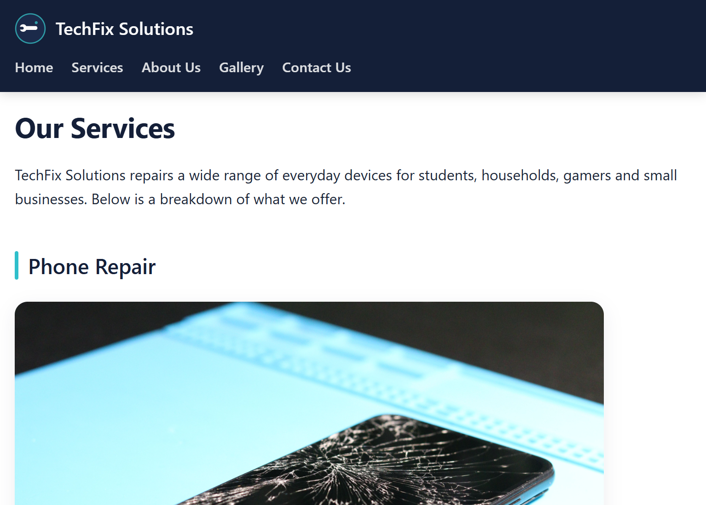
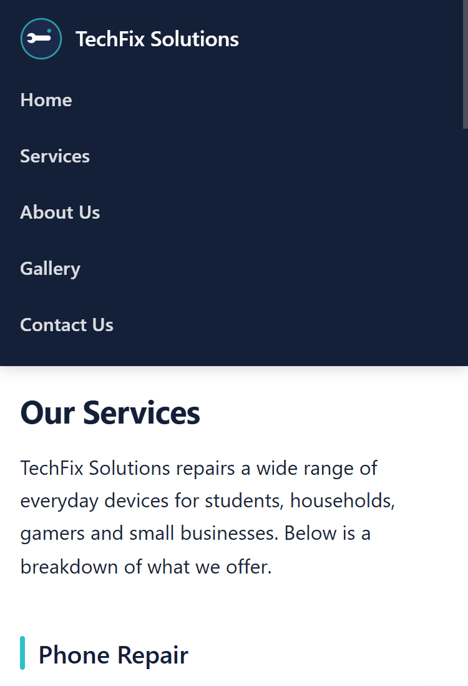

# TechFix Solutions – Website (WEDE5020 Part 2)

Multi-page website for a fictional local tech repair business.

## Pages
- index.html – Home
- services.html – Services
- about.html – About Us
- gallery.html – Completed repairs
- contact.html – Contact form and details

## How to view
1. Open the project folder in VS Code
2. Open index.html with Live Server (or open in a browser)
3. Resize the browser to test tablet and mobile layouts

## Technologies
- HTML5
- CSS3 (Flexbox, Grid, media queries, pseudo-classes)
- Google Fonts (Outfit, Plus Jakarta Sans)

## Folder structure
techfix/
├── index.html
├── services.html
├── about.html
├── gallery.html
├── contact.html
├── css/
│   └── style.css
└── images/
## References
- Google Fonts – Outfit & Plus Jakarta Sans: https://fonts.google.com
- MDN Web Docs – CSS Flexbox, Grid, Media Queries: https://developer.mozilla.org
- W3Schools – CSS pseudo-classes https://www.w3schools.com/css/ 
- Rosebank International / IIE WEDE5020 CSS Fundamentals slides (Parts 1 & 2)

## Screenshots

